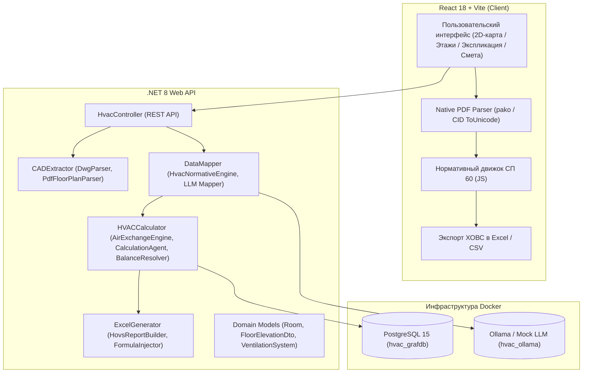

# 🌬️ AI Agent of Ventilation (hvac-auto-calculator) — Документация и Wiki

Комплексная техническая вики проекта **AI Agent of Ventilation** — интеллектуальной системы автоматизированного проектирования и расчета систем вентиляции (ОВиК / HVAC), нормативного воздухообмена и выпуска проектной документации по **ГОСТ 21.602** и **СП 60.13330.2020**.

---

## 📑 Содержание

1. [Обзор проекта и решаемые задачи](#1-обзор-проекта-и-решаемые-задачи)
2. [Общая архитектура системы](#2-общая-архитектура-системы)
3. [Модули бэкенда (.NET 8)](#3-модули-бэкенда-net-8)
   - [3.1. Domain (Доменные сущности и интерфейсы)](#31-domain-доменные-сущности-и-интерфейсы)
   - [3.2. CADExtractor (Парсинг PDF и DWG/DXF)](#32-cadextractor-парсинг-pdf-и-dwgdxf)
   - [3.3. DataMapper (Интеграция, LLM и нормативный движок)](#33-datamapper-интеграция-llm-и-нормативный-движок)
   - [3.4. HVACCalculator (Мультиагентный расчет и сведение баланса)](#34-hvaccalculator-мультиагентный-расчет-и-сведение-баланса)
   - [3.5. ExcelGenerator (Генерация отчетов ХОВС и инъекция формул)](#35-excelgenerator-генерация-отчетов-ховс-и-инъекция-формул)
   - [3.6. GraphDB (Топологическая модель и связи)](#36-graphdb-топологическая-модель-и-связи)
4. [Клиентская часть (React Frontend)](#4-клиентская-часть-react-frontend)
   - [4.1. Модульная структура компонентов](#41-модульная-структура-компонентов)
   - [4.2. Нативный PDF-парсер без демо-заглушек](#42-нативный-pdf-парсер-без-демо-заглушек)
   - [4.3. Прямая модель высоты этажа (без вычета плиты)](#43-прямая-модель-высоты-этажа-без-вычета-плиты)
5. [Нормативно-техническая база и открытые формулы расчетов](#5-нормативно-техническая-база-и-открытые-формулы-расчетов)
6. [Формирование ведомости ХОВС и спецификации Excel](#6-формирование-ведомости-ховс-и-спецификации-excel)
7. [Инфраструктура и запуск в Docker](#7-инфраструктура-и-запуск-в-docker)
8. [Тестирование и покрытие (xUnit)](#8-тестирование-и-покрытие-xunit)
9. [Планы развития и рекомендации](#9-планы-развития-и-рекомендации)

---

## 1. Обзор проекта и решаемые задачи

В традиционном проектировании ОВиК инженер тратит до 60-70% времени на рутинные операции:
- Ручной замер площадей и высот помещений с чертежей (САПР / PDF);
- Сбор экспликаций помещений и атрибутов (число людей, категории пожароопасности, теплопритоки);
- Ручной подбор нормативных формул и кратностей по десяткам СП;
- Сведение воздушного баланса здания и компенсация дисбаланса;
- Формирование таблиц ХОВС (Характеристика отопительно-вентиляционных систем) по форме ГОСТ 21.602.

**AI Agent of Ventilation** автоматизирует полный пайплайн от входного чертежа до готовой спецификации и сметы:
- **Настоящий парсинг PDF-планов**: извлечение реальной экспликации и точных CAD-координат комнат без сваливания в демо-данные;
- **Прямой учет чистой высоты этажа**: высота $\Delta h$ считывается прямо из чертежа PDF (например, 3.600 м для подземной автостоянки) или рассчитывается по разности отметок без принуждения пользователя рассчитывать толщину перекрытия $\delta_{\text{плиты}}$;
- **Прозрачные ссылки на СП и расчетные формулы**: в отчеты Excel (ХОВС) включаются явные ссылки на нормативный документ (СП 60.13330, СП 113.13330, СП 118.13330, СанПиН) и детальная формула с реальными числами ($L_{\text{выт}} = K \times V = 5.0 \times 14295.99 = 71480\text{ м}^3/\text{ч}$);
- **Интерактивная 2D-карта с цветовой дифференциацией**: 10 нормативных категорий помещений с уникальными цветами, бейджами, поиском и инспектором.

---

## 2. Общая архитектура системы



---

## 3. Модули бэкенда (.NET 8)

### 3.1. Domain (`src/Domain`)
Содержит доменные модели:
- `Room`: номер, наименование, категория СП, площадь $S$, высота $H$, объем $V$, кратность, расходы $L_{\text{пр}}$ и $L_{\text{выт}}$, нормативный документ `NormCode`, методика `CalculationMethod`, развернутая формула `CalculationFormula`, CAD-координаты.
- `FloorElevationDto`: отметка низа $H_{\text{bot}}$, отметка верха $H_{\text{top}}$, прямое переопределение высоты `HeightOverride`. Чистая высота $\Delta h$ определяется как $|H_{\text{top}} - H_{\text{bot}}|$ либо берется напрямую без вычитания плиты.
- `VentilationSystem`: системы притока (П) и вытяжки (В), список обслуживаемых помещений, суммарный расход с 10% запасом по СП 60.13330.

### 3.2. CADExtractor (`src/CADExtractor`)
- `PdfFloorPlanParser`: выполняет разжатие `/FlateDecode` через `ZLibStream`, восстанавливает ToUnicode CMap шрифтов AutoCAD, извлекает номера комнат, площади, наименования и CAD-координаты на плане. Автоматически извлекает отметку этажа (напр. `-18,600`) и задает правильную высоту $\Delta h = 3.6\text{ м}$.
- Фильтрует даты штампов (`24.03.26`) и шифры листов (`01.01.00`).

### 3.3. DataMapper (`src/DataMapper`)
- `HvacNormativeEngine`: классифицирует помещения по СП 60.13330, СП 113.13330, СП 118.13330, СП 54.13330, СанПиН 1.2.3685-21.
- Генерирует точную формулу расчета:
  - Автостоянка: `Lпр = 4.0 × V; Lвыт = 5.0 × V (дисбаланс -20%)`
  - ПУИ / Санузлы: `Lвыт = max(75..100, 5.0 × V); Lпр = 0 (переток)`
  - Офисы: `Lпр = N чел × 60 м³/ч; Lвыт = N чел × 55 м³/ч`
  - Венткамеры / ИТП: `Lпр = K × V; Lвыт = K × V`

### 3.4. HVACCalculator (`src/HVACCalculator`)
- Мультиагентный расчет воздухообмена, группировка комнат по системам, сведение дисбаланса.

### 3.5. ExcelGenerator (`src/ExcelGenerator`)
- `HovsReportBuilder`: формирует таблицы по ГОСТ 21.602 в ClosedXML.
- Добавляет колонки «Нормативный документ (СП / ГОСТ)», «Методика расчета», «Формула расчета воздухообмена».
- Внедряет динамические формулы Excel:
  - Объем: `=ROUND(D2*E2, 2)`
  - Дисбаланс: `=J2-K2`
  - Итоги: `=SUM(...)`

---

## 4. Клиентская часть (React Frontend)

### 4.1. Модульная структура компонентов
Frontend разбит на независимые модули в `frontend/src`:
- `constants/categories.js`: 10 нормативных категорий помещений со своими цветами, обводками и стилями;
- `utils/pdfParser.js`: нативный парсер PDF с `pako`;
- `utils/elevations.js`: прямое определение чистой высоты $\Delta h$;
- `utils/normsEngine.js`: расчет воздухообмена и текстовых формул;
- `utils/exportExcel.js`: экспорт ведомости ХОВС;
- `pages/PlanCanvas.jsx`: интерактивная SVG-карта с зумом к курсору;
- `pages/FloorsPage.jsx`: менеджер этажей без плиты;
- `pages/ElevationFormulaCard.jsx`: карточка расчета высоты;
- `pages/ExplicationPage.jsx`: таблица экспликации с колонками СП и формул.

### 4.2. Нативный PDF-парсер без демо-заглушек
Благодаря библиотеке `pako`, браузер распаковывает zlib-потоки чертежей AutoCAD напрямую. При загрузке реального PDF-файла (например, `K32_Лист_2_План_5_этажа_на_отметке_18,600_Layout1.pdf`) извлекаются все 25-26 реальных помещений со своими площадями, категориями пожароопасности и координатами без падения в демо-данные.

### 4.3. Прямая модель высоты этажа (без вычета плиты)
Пользователь больше не тратит время на расчет и ввод толщины плиты $\delta_{\text{плиты}}$. Чистая высота этажа $\Delta h$:
1. Автоматически считывается из чертежа PDF (например, 3.6 м для автостоянки на отметке -18.600 м);
2. Задается напрямую числом в таблице этажей;
3. Либо вычисляется по разности отметок: $\Delta h = |H_{\text{top}} - H_{\text{bot}}|$.

---

## 5. Нормативно-техническая база и открытые формулы расчетов

| Категория помещения | Нормативный документ | Методика расчета | Формула воздухообмена |
|---|---|---|---|
| **Автостоянка подземная** | СП 60.13330.2020 / СП 113.13330 | По кратности (разрежение -20%) | $L_{\text{пр}} = 4.0 \times V$, $L_{\text{выт}} = 5.0 \times V$ |
| **Комната уборочного инвентаря (ПУИ)** | СП 118.13330.2022 п. 7.2 | По кратности с нижним порогом | $L_{\text{выт}} = \max(100, 5.0 \times V)$, $L_{\text{пр}} = 0$ |
| **Санузлы и душевые** | СП 118.13330.2022 / СП 54.13330 | Санитарная норма | $L_{\text{выт}} = \max(75, 5.0 \times V)$, $L_{\text{пр}} = 0$ |
| **Электрощитовая / ИБП / СС** | СП 60.13330.2020 / ПУЭ | Ассимиляция теплоизбытков | $L_{\text{выт}} = 1.0 \times V$, $L_{\text{пр}} = 0$ |
| **Венткамера / Хладоцентр** | СП 60.13330.2020 п. 7.1 | По кратности (баланс) | $L_{\text{пр}} = 1.0 \times V$, $L_{\text{выт}} = 1.0 \times V$ |
| **ИТП / Насосная станция** | СП 41-101-95 / СП 60.13330.2020 | По кратности | $L_{\text{пр}} = 3.0 \times V$, $L_{\text{выт}} = 3.0 \times V$ |
| **Тамбур-шлюз / Холл с подпором** | СП 7.13130.2013 / СП 60.13330 | Подпор воздуха ($\Delta P \ge 20\text{ Па}$) | $L_{\text{пр}} = \max(100, 1.5 \times V)$, $L_{\text{выт}} = 0$ |
| **Офисы и кабинеты** | СП 60.13330.2020 / СанПиН 1.2.3685-21 | По числу людей | $L_{\text{пр}} = N_{\text{чел}} \times 60$, $L_{\text{выт}} = N_{\text{чел}} \times 55$ |
| **Кладовые и склады** | СП 60.13330.2020 / СП 54.13330 | По кратности (разрежение) | $L_{\text{пр}} = 1.0 \times V$, $L_{\text{выт}} = 1.5 \times V$ |
| **Коридоры и МОП** | СП 60.13330.2020 | По кратности | $L_{\text{пр}} = 1.0 \times V$, $L_{\text{выт}} = 0.5 \times V$ |

---

## 6. Формирование ведомости ХОВС и спецификации Excel

Генерируемый Excel-файл содержит:
1. **Вкладка «Помещения и Площади»**:
   - Номер помещения, наименование, категория СП, площадь $S$, высота $H$, объем $V$ (формула `=ROUND(D2*E2, 2)`);
   - Явная колонка с нормативным документом (**СП 60.13330.2020 / СП 113.13330**);
   - Колонка с методикой расчета;
   - Колонка с детальной формулой воздухообмена;
   - Приток $L_{\text{пр}}$, вытяжка $L_{\text{выт}}$, дисбаланс $\Delta L$ (формула `=J2-K2`);
   - Итоговая строка этажа с формулами `=SUM(...)`.
2. **Вкладка «ХОВС ГОСТ 21.602»**:
   - Обозначение системы, тип установки, список обслуживаемых зон, площадь, расход с запасом 10% и ссылки на стандарты.

---

## 7. Инфраструктура и запуск в Docker

Сервисы описаны в `infrastructure/docker-compose.yml`:
- Frontend: `http://localhost:3000`
- Backend API: `http://localhost:5000`
- База данных: `localhost:5433` (PostgreSQL 15)
- LLM Service: `localhost:11434`

### Пересборка и запуск:
```bash
# Пересборка клиентской части
cd /home/roman/AI-agent_of_ventilation/frontend
npm run build

# Перезапуск сервисов в Docker
cd /home/roman/AI-agent_of_ventilation/infrastructure
/snap/bin/docker-compose restart frontend
```

---

## 8. Тестирование и покрытие (xUnit)

Проект протестирован с помощью xUnit в `tests/HVACCalculator.Tests`:

```bash
dotnet test /home/roman/AI-agent_of_ventilation/hvac-auto-calculator.sln
```

### Результат выполнения тестов:
```text
Passed!  - Failed: 0, Passed: 10, Skipped: 0, Total: 10, Duration: 779 ms
```

### Тестовые наборы:
1. **`AirExchangeTests`**:
   - `CalculateFlow_OfficeWithWindows_CalculatesByPeople`: расчет офиса по санитарной норме на человека ($60\text{ м}^3/\text{ч}$);
   - `CalculateFlow_SanNuzel_CalculatesByFixedNorm`: фиксированная санитарная вытяжка санузла;
   - `ApplyNormsAsync_Parking_SetsSpCitationAndDetailedFormula`: проверка паркинга по СП 113.13330 с формулой $K=4/K=5$ и отрицательным балансом;
   - `ApplyNormsAsync_Pui_SetsMin100AndSp118`: проверка вытяжки ПУИ не менее $100\text{ м}^3/\text{ч}$ по СП 118.13330;
   - `ApplyNormsAsync_VentChamber_CalculatesBalancedFlow`: проверка баланса венткамеры $K=1.0$ по СП 60.13330.
2. **`FloorElevationTests`**:
   - `NetHeight_CalculatedDirectlyFromElevationDelta_WithoutSlabThickness`: проверка чистой высоты $\Delta h$ без вычета плиты;
   - `NetHeight_WithExplicitHeightOverride_UsesOverrideDirectly`: прямое переопределение чистой высоты;
   - `RoomVolume_UsesFloorHeightDirectly`: расчет объема помещения $V = S \times \Delta h$.
3. **`HovsReportBuilderTests`**:
   - `GenerateFullWorkbook_IncludesNormativeCitationAndFormulaColumns`: проверка создания Excel с 14 колонками, ссылками на СП, формулами и формулами ClosedXML (`ROUND`, `SUM`).
4. **`PdfFloorPlanParserTests`**:
   - `ExtractGeometryAsync_ExtractsRoomsAndHeightFromRealPdf`: проверка извлечения реального плана этажа `-5` на отметке `-18.600` (более 20 реальных комнат, включая автостоянку площадью более 4000 м² и высоту 3.6 м).
