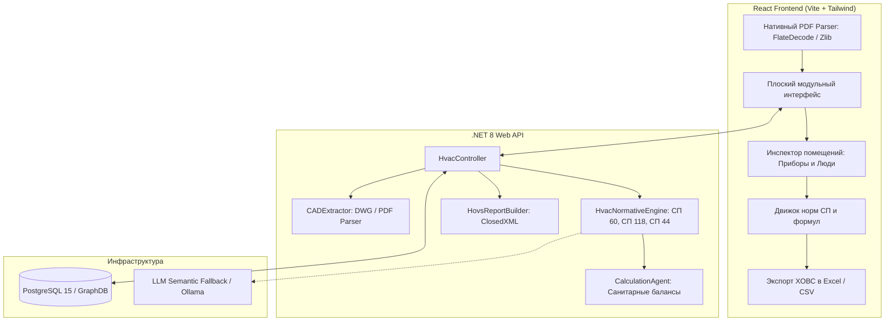

# 🌬️ AI Agent of Ventilation (hvac-auto-calculator) — Документация и Wiki

Комплексная техническая вики проекта **AI Agent of Ventilation** — интеллектуальной системы автоматизированного проектирования и расчета систем вентиляции (ОВиК / HVAC), нормативного воздухообмена и выпуска проектной документации по **ГОСТ 21.602** и **СП 60.13330.2020**.

---

## 📑 Содержание

1. [Обзор проекта и решаемые задачи](#1-обзор-проекта-и-решаемые-задачи)
2. [Общая архитектура системы](#2-общая-архитектура-системы)
3. [Модули бэкенда (.NET 8)](#3-модули-бэкенда-net-8)
   - [3.1. Domain (Доменные сущности и интерфейсы)](#31-domain-доменные-сущности-и-интерфейсы)
   - [3.2. CADExtractor (Парсинг PDF и DWG/DXF)](#32-cadextractor-парсинг-pdf-и-dwgdxf)
   - [3.3. DataMapper (Интеграция, LLM и нормативный движок)](#33-datamapper-интеграция-llm-и-нормативный-движок)
   - [3.4. HVACCalculator (Мультиагентный расчет и сведение баланса)](#34-hvaccalculator-мультиагентный-расчет-и-сведение-баланса)
   - [3.5. ExcelGenerator (Генерация отчетов ХОВС и инъекция формул)](#35-excelgenerator-генерация-отчетов-ховс-и-инъекция-формул)
   - [3.6. GraphDB (Топологическая модель и связи)](#36-graphdb-топологическая-модель-и-связи)
4. [Клиентская часть (React Frontend)](#4-клиентская-часть-react-frontend)
   - [4.1. Модульная структура компонентов](#41-модульная-структура-компонентов)
   - [4.2. Плоский инженерный стиль (Flat Solid Design без градиентов)](#42-плоский-инженерный-стиль-flat-solid-design-без-градиентов)
   - [4.3. Нативный PDF-парсер без демо-заглушек](#43-нативный-pdf-парсер-без-демо-заглушек)
   - [4.4. Прямая модель высоты этажа (без вычета плиты)](#44-прямая-модель-высоты-этажа-без-вычета-плиты)
5. [Инженерный аудит расчетов и нормативно-техническая база СП](#5-инженерный-аудит-расчетов-и-нормативно-техническая-база-сп)
   - [5.1. Расчет санузлов строго по санитарным приборам](#51-расчет-санузлов-строго-по-санитарным-приборам)
   - [5.2. Расчет офисов строго по людям и рабочим местам](#52-расчет-офисов-строго-по-людям-и-рабочим-местам)
   - [5.3. Сводная таблица нормативов воздухообмена](#53-сводная-таблица-нормативов-воздухообмена)
6. [Формирование ведомости ХОВС и спецификации Excel](#6-формирование-ведомости-ховс-и-спецификации-excel)
7. [Инфраструктура и запуск в Docker](#7-инфраструктура-и-запуск-в-docker)
8. [Тестирование и покрытие (xUnit)](#8-тестирование-и-покрытие-xunit)
9. [Планы развития и рекомендации](#9-планы-развития-и-рекомендации)

---

## 1. Обзор проекта и решаемые задачи

В традиционном проектировании ОВиК инженер тратит до 60-70% времени на рутинные операции:
- Ручной замер площадей и высот помещений с чертежей (САПР / PDF);
- Сбор экспликаций помещений и атрибутов (число людей, категории пожароопасности, сан. приборы);
- Ручной подбор нормативных формул и кратностей по десяткам СП;
- Сведение воздушного баланса здания и компенсация дисбаланса;
- Формирование таблиц ХОВС (Характеристика отопительно-вентиляционных систем) по форме ГОСТ 21.602.

**AI Agent of Ventilation** автоматизирует полный пайплайн от входного чертежа до готовой спецификации и сметы:
- **Настоящий парсинг PDF-планов**: извлечение реальной экспликации и точных CAD-координат комнат без сваливания в демо-данные;
- **Прямой учет чистой высоты этажа**: высота $\Delta h$ считывается прямо из чертежа PDF (например, 3.600 м для подземной автостоянки) или рассчитывается по разности отметок $\Delta H = |H_{\text{top}} - H_{\text{bot}}|$ без необходимости заставлять проектировщика высчитывать толщину плит перекрытий;
- **Расчет санузлов по сан. приборам**: унитазы (50 м³/ч), писсуары (25 м³/ч), душевые сетки (75 м³/ч), раковины (20 м³/ч) по СП 118.13330.2022 табл. 7.1 и СП 44.13330.2011;
- **Расчет офисов строго по людям**: 60 м³/ч на человека (без проветривания) или 40 м³/ч (с открывающимися окнами), плотность $6\text{ м}^2/\text{чел}$ по СанПиН 1.2.3685-21;
- **Профессиональный инженерный интерфейс**: плоский solid-дизайн без визуального шума и градиентов;
- **Генерация отчетов Excel с формулами и ссылками на СП**: открытые формулы `=ROUND(D2*E2, 2)`, `=SUM(...)` и нормативные обоснования.

---

## 2. Общая архитектура системы



---

## 3. Модули бэкенда (.NET 8)

### 3.1. Domain (Доменные сущности и интерфейсы)
- **`Room`**: содержит геометрические атрибуты ($S$, $H$, $V$), высотные отметки, количество сотрудников `PeopleCount`, признак естественного проветривания `HasNaturalVentilation`, счетчики сан. приборов (`ToiletCount`, `UrinalCount`, `ShowerCount`, `SinkCount`), нормативные ссылки (`NormCode`, `NormCitation`, `CalculationFormula`), расходы воздуха $L_{\text{пр}}$ и $L_{\text{выт}}$, баланс $\Delta L$, систему вентиляции `SystemTag`.
- **`VentilationSystem`**: представляет приточную ($П$) или вытяжную ($В$) установку, суммарный расход с запасом +10%, сечения воздуховодов по скоростям $v_1 = 4.5\text{ м/с}$, $v_2 = 2.5\text{ м/с}$, площадь стали и спецификацию оборудования.

### 3.2. CADExtractor (Парсинг PDF и DWG/DXF)
- **`PdfFloorPlanParser`**: декодирует контентные потоки PDF, парсит текстовые блоки экспликации, отметки уровня (например `-18.600`) и полигональные границы помещений.
- **`DwgParser`**: читает слои `A-WALL`, `A-ROOM`, полилинии `LWPOLYLINE` и штампы AutoCAD.

### 3.3. DataMapper (Интеграция, LLM и нормативный движок)
- **`HvacNormativeEngine`**: реализует дерево правил актуализированных редакций СП:
  - Автостоянки: СП 113.13330 и СП 60.13330 (вытяжка $K=5$, приток $K=4$, разрежение -20%);
  - Санузлы и душевые: СП 118.13330.2022 табл. 7.1, СП 44.13330.2011 (расчет по приборам: 50 м³/ч унитаз, 25 м³/ч писсуар, 75 м³/ч душ, переток);
  - Офисы и кабинеты: СП 60.13330.2020 п. 7.1, СанПиН 1.2.3685-21 (60 м³/ч без окон, 40 м³/ч с окнами, плотность 6 м²/чел);
  - Электрощитовые: ПУЭ и СП 60.13330 (ассимиляция тепла, $K=1.0$, приток 0);
  - Венткамеры и ИТП: СП 60.13330 и СП 41-101-95;
  - ПУИ: СП 118.13330 п. 7.2 (вытяжка $5 \times V$, не менее 100 м³/ч).

### 3.4. HVACCalculator (Мультиагентный расчет и сведение баланса)
- **`CalculationAgent`**: распределяет расходы по зонам, сводит аэродинамический баланс $\sum L_{\text{пр}} - \sum L_{\text{выт}}$, определяет компенсирующий переток.

### 3.5. ExcelGenerator (Генерация отчетов ХОВС и инъекция формул)
- **`HovsReportBuilder`**: строит многостраничные книги ClosedXML с 15-колоночной таблицей экспликации, колонкой нормативных ссылок СП, формулами расчета, ячейками с формулами Excel (`=ROUND(D2*E2, 2)`, `=SUM(...)`) и второй вкладкой «ХОВС ГОСТ 21.602».

---

## 4. Клиентская часть (React Frontend)

### 4.1. Модульная структура компонентов
Интерфейс декомпозирован на независимые страницы и компоненты:
```
frontend/src/
├── components/
│   ├── layout/       # Sidebar.jsx, Header.jsx
│   ├── kpi/          # KpiCards.jsx
│   └── common/       # AlertBanner.jsx
├── pages/
│   ├── MapPage.jsx               # 2D-план этажа, SVG Canvas (Pan/Zoom)
│   ├── PlanCanvas.jsx            # Отрисовка комнат, интерактивный выбор
│   ├── RoomInspector.jsx         # Инспектор помещения: приборы, люди, высота
│   ├── CategoryLegend.jsx        # Легенда категорий СП и баланса
│   ├── FloorsPage.jsx            # Менеджер отметок и высот этажей
│   ├── ElevationFormulaCard.jsx  # Карточка определения высоты Δh
│   ├── ExplicationPage.jsx       # Экспликация, поиск, баланс, нормы СП
│   └── EstimatePage.jsx          # Группировка систем ОВиК, воздуховоды, смета
└── utils/
    ├── normsEngine.js            # Локальный нормативный калькулятор СП
    ├── elevations.js             # Расчет чистой высоты по отметкам
    ├── pdfParser.js              # Нативный FlateDecode-парсер PDF
    ├── estimateCalc.js           # Аэродинамика и смета
    └── exportExcel.js            # Генерация CSV/Excel по ГОСТ 21.602
```

### 4.2. Плоский инженерный стиль (Flat Solid Design без градиентов)
По требованию проектировщиков исключен визуальный шум и градиентные заливки (`bg-gradient-to-...`, `from-... to-...`):
- Фон приложения: глубокий плоский инженерный темный тон `#040d1a` / `#0b192c`;
- Границы панелей: контрастные контуры `border-[#1e3a5f]`;
- Кнопки и активные пункты: четкие однотонные заливки (`bg-emerald-600`, `bg-blue-600`) без размытий;
- Улучшена читаемость числовых таблиц и шрифтов с моноширинными цифрами.

### 4.3. Нативный PDF-парсер без демо-заглушек
При загрузке проектного PDF (например, `K32_Лист_2_План_5_этажа_на_отметке_18,600_Layout1.pdf`):
- Алгоритм распаковывает сжатые потоки `pako.inflate`;
- Извлекает из текстовых блоков номера и наименования всех комнат (все 25+ помещений этажа);
- Определяет высотную отметку пола (`-18.600`) и присваивает высоту этажа $\Delta h = 3.60\text{ м}$.

### 4.4. Прямая модель высоты этажа (без вычета плиты)
Пользователь освобожден от рутинного замера и вычитания толщины перекрытий:
$$\Delta H = |H_{\text{top}} - H_{\text{bot}}|$$
- Если на чертеже отметка пола $-18.600$, а вышележащего этажа $-15.000$, чистая высота автоматически принимается равной $3.60\text{ м}$;
- Для помещений с подвесным потолком (офисы, переговорные, санузлы) в карточке помещения можно индивидуально переопределить рабочую высоту $h_{\text{подв}} = 2.7\text{--}3.0\text{ м}$.

---

## 5. Инженерный аудит расчетов и нормативно-техническая база СП

На основе аудита рабочей документации реального стилобата объекта «Кутузовский 32В»:

### 5.1. Расчет санузлов строго по санитарным приборам
В соответствии с **СП 118.13330.2022 табл. 7.1** и **СП 44.13330.2011**:
- Унитаз: $50\text{ м}^3/\text{ч}$ на 1 прибор;
- Писсуар: $25\text{ м}^3/\text{ч}$ на 1 прибор;
- Душевая сетка: $75\text{ м}^3/\text{ч}$ на 1 душевую сетку;
- Умывальник / раковина: $20\text{ м}^3/\text{ч}$ на 1 прибор;
- Приток: $L_{\text{пр}} = 0$ (компенсируется перетоком из смежных коридоров через решетки или подрез полотна двери).

**Формула расчета**:
$$L_{\text{выт}} = N_{\text{унит}} \times 50 + N_{\text{писс}} \times 25 + N_{\text{душ}} \times 75 + N_{\text{умыв}} \times 20$$
*Пример из проекта инженера:* Мужской санузел (пом. -2.54): 2 унитаза + 3 писсуара $\Rightarrow L_{\text{выт}} = 2 \times 50 + 3 \times 25 = 175\text{ м}^3/\text{ч}$.

### 5.2. Расчет офисов строго по людям и рабочим местам
В соответствии с **СП 60.13330.2020 п. 7.1** и **СанПиН 1.2.3685-21**:
- Воздухообмен определяется по санитарной норме подачи наружного воздуха на 1 человека:
  - Без естественного проветривания: $60\text{ м}^3/\text{ч}$ на 1 сотрудника;
  - С открывающимися окнами: $40\text{ м}^3/\text{ч}$ на 1 сотрудника;
  - Переговорные и конференц-залы: $40\text{ м}^3/\text{ч}$ на 1 место;
- Плотность размещения при отсутствии экспликации мебели:
  $$N_{\text{чел}} = \max\left(1, \lceil S / 6.0 \rceil\right)$$
  (норма $6\text{ м}^2$ на 1 рабочее место с компьютером по СанПиН);
- Баланс: $L_{\text{выт}} = L_{\text{пр}}$ (полная компенсация вытяжки притоком).

### 5.3. Сводная таблица нормативов воздухообмена

| Категория помещения | Нормативный документ | Базовый метод | Формула расчета |
|---|---|---|---|
| **Автостоянка подземная** | СП 60.13330 / СП 113.13330 | Кратность (ПДК CO) | $L_{\text{выт}} = 5.0 \times V$, $L_{\text{пр}} = 4.0 \times V$ (разрежение -20%) |
| **Санузел / Уборная** | СП 118.13330.2022 табл. 7.1, СП 44.13330 | По сан. приборам | $L_{\text{выт}} = N_{\text{унит}} \times 50 + N_{\text{писс}} \times 25$, $L_{\text{пр}} = 0$ (переток) |
| **Душевая** | СП 118.13330.2022 / СП 44.13330 | По душевым сеткам | $L_{\text{выт}} = N_{\text{душ}} \times 75$, $L_{\text{пр}} = 0$ (переток) |
| **Офисы, кабинеты, переговорные** | СП 60.13330.2020 п. 7.1 / СанПиН 1.2.3685-21 | По числу людей | $L_{\text{пр}} = N_{\text{чел}} \times 60$, $L_{\text{выт}} = L_{\text{пр}}$ (по балансу) |
| **ПУИ / Комната инвентаря** | СП 118.13330.2022 п. 7.2 | Кратность (min 100 м³/ч) | $L_{\text{выт}} = \max(100, 5.0 \times V)$, $L_{\text{пр}} = 0$ (переток) |
| **Электрощитовая / СС / ИБП** | СП 60.13330.2020 / ПУЭ | Ассимиляция тепла | $L_{\text{выт}} = 1.0 \times V$, $L_{\text{пр}} = 0$ (мех. приток не требуется) |
| **Дизель-генераторная (ДЭС)** | СП 60.13330.2020 | Технологический | $L_{\text{пр}} = 5.0 \times V$, $L_{\text{выт}} = 6.0 \times V$ |
| **Венткамера** | СП 60.13330.2020 п. 7.1 | Кратность | $L_{\text{пр}} = 1.0 \times V$, $L_{\text{выт}} = 1.0 \times V$ |
| **ИТП / Насосная станция** | СП 41-101-95 / СП 60.13330 | Кратность | $L_{\text{пр}} = 3.0 \times V$, $L_{\text{выт}} = 3.0 \times V$ |
| **Тамбур-шлюз / Холл с подпором** | СП 7.13130.2013 / СП 60.13330 | Подпор воздуха ($\Delta P \ge 20\text{ Па}$) | $L_{\text{пр}} = \max(100, 1.5 \times V)$, $L_{\text{выт}} = 0$ |
| **Кладовые и склады** | СП 60.13330.2020 / СП 54.13330 | Кратность (разрежение) | $L_{\text{пр}} = 1.0 \times V$, $L_{\text{выт}} = 1.5 \times V$ |
| **Коридоры и МОП** | СП 60.13330.2020 | Кратность | $L_{\text{пр}} = 1.0 \times V$, $L_{\text{выт}} = 0.5 \times V$ |

---

## 6. Формирование ведомости ХОВС и спецификации Excel

Генерируемый Excel-файл содержит:
1. **Вкладка «Помещения и Площади»**:
   - Номер помещения, наименование, категория СП, площадь $S$, высота $H$, объем $V$ (формула `=ROUND(D2*E2, 2)`);
   - Колонка «Люди / Сан. приборы» (с указанием точного числа унитазов, писсуаров или сотрудников);
   - Нормативный документ (**СП 118.13330.2022 / СП 60.13330.2020 / СанПиН 1.2.3685-21**);
   - Методика расчета;
   - Детальная формула воздухообмена с промежуточными множителями;
   - Приток $L_{\text{пр}}$, вытяжка $L_{\text{выт}}$, дисбаланс $\Delta L$ (формула `=K2-L2`);
   - Итоговая строка этажа с формулами `=SUM(...)`.
2. **Вкладка «ХОВС ГОСТ 21.602»**:
   - Обозначение системы, тип установки, список обслуживаемых зон, площадь, расход с запасом 10% и ссылки на стандарты.

---

## 7. Инфраструктура и запуск в Docker

Сервисы описаны в `infrastructure/docker-compose.yml`:
- Frontend: `http://localhost:3000` (Nginx serving `dist`)
- Backend API: `http://localhost:5000` (.NET 8 Web API)
- База данных: `localhost:5433` (PostgreSQL 15)
- LLM Service: `localhost:11434`

### Пересборка и запуск:
```bash
# Пересборка клиентской части
cd /home/roman/AI-agent_of_ventilation/frontend
npm run build

# Перезапуск сервисов в Docker
cd /home/roman/AI-agent_of_ventilation/infrastructure
docker compose up -d
```

---

## 8. Тестирование и покрытие (xUnit)

Проект протестирован с помощью xUnit в `tests/HVACCalculator.Tests`:

```bash
dotnet test /home/roman/AI-agent_of_ventilation/hvac-auto-calculator.sln
```

### Результат выполнения тестов:
```text
Passed!  - Failed: 0, Passed: 14, Skipped: 0, Total: 14, Duration: 795 ms
```

### Тестовые наборы:
1. **`AirExchangeTests`**:
   - `ApplyNormsAsync_Restroom_CalculatesByToiletsAndUrinals`: расчет санузла по 2 унитазам и 3 писсуарам ($2 \times 50 + 3 \times 25 = 175\text{ м}^3/\text{ч}$) по СП 118.13330;
   - `ApplyNormsAsync_Restroom_AutoDeterminesCombinedToiletAndUrinal`: автоопределение совмещенного санузла (1 унитаз + 1 писсуар = 75 м³/ч) по строке 18 экспликации инженера;
   - `ApplyNormsAsync_Office_CalculatesStrictlyByPeople`: расчет офиса строго по людям ($4\text{ чел} \times 60 = 240\text{ м}^3/\text{ч}$) по СП 60.13330 и СанПиН 1.2.3685-21;
   - `ApplyNormsAsync_OfficeWithWindows_Uses40M3PerHour`: расчет офиса с естественным проветриванием ($3\text{ чел} \times 40 = 120\text{ м}^3/\text{ч}$);
   - `CalculateFlow_OfficeWithWindows_CalculatesByPeople`: санитарная норма CalculationAgent;
   - `CalculateFlow_SanNuzel_CalculatesByFixedNorm`: базовая санитарная вытяжка CalculationAgent;
   - `ApplyNormsAsync_Parking_SetsSpCitationAndDetailedFormula`: проверка паркинга по СП 113.13330 с формулой $K=4/K=5$ и отрицательным балансом;
   - `ApplyNormsAsync_Pui_SetsMin100AndSp118`: проверка вытяжки ПУИ не менее $100\text{ м}^3/\text{ч}$ по СП 118.13330;
   - `ApplyNormsAsync_VentChamber_CalculatesBalancedFlow`: проверка баланса венткамеры $K=1.0$ по СП 60.13330.
2. **`FloorElevationTests`**:
   - `NetHeight_CalculatedDirectlyFromElevationDelta_WithoutSlabThickness`: проверка чистой высоты $\Delta h$ без вычета плиты;
   - `NetHeight_WithExplicitHeightOverride_UsesOverrideDirectly`: прямое переопределение чистой высоты;
   - `RoomVolume_UsesFloorHeightDirectly`: расчет объема помещения $V = S \times \Delta h$.
3. **`HovsReportBuilderTests`**:
   - `GenerateFullWorkbook_IncludesNormativeCitationAndFormulaColumns`: проверка создания Excel с 15 колонками, приборами, людьми, ссылками на СП, формулами и формулами ClosedXML (`ROUND`, `SUM`).
4. **`PdfFloorPlanParserTests`**:
   - `ExtractGeometryAsync_ExtractsRoomsAndHeightFromRealPdf`: проверка извлечения реального плана этажа `-5` на отметке `-18.600` (более 20 реальных комнат, включая автостоянку площадью более 4000 м² и высоту 3.6 м).

---

## 9. Планы развития и рекомендации

1. **Импорт DWG-файлов поэтажных планов**: парсинг блоков сантехники (`ACAD_PROXY_ENTITY`, блоки унитазов и писсуаров) для автоматического подсчета приборов без ручного ввода.
2. **Интеграция спецификации вентиляционного оборудования КУБ**: сопоставление рассчитанных расходов $L$ и давлений $P$ с базой приточно-вытяжных установок из файла `ХОВС_К32В_СТИЛОБАТ (9).xlsx`.
3. **Экспорт планов с трассировкой воздуховодов в DXF/DWG** для загрузки в AutoCAD и Revit.
